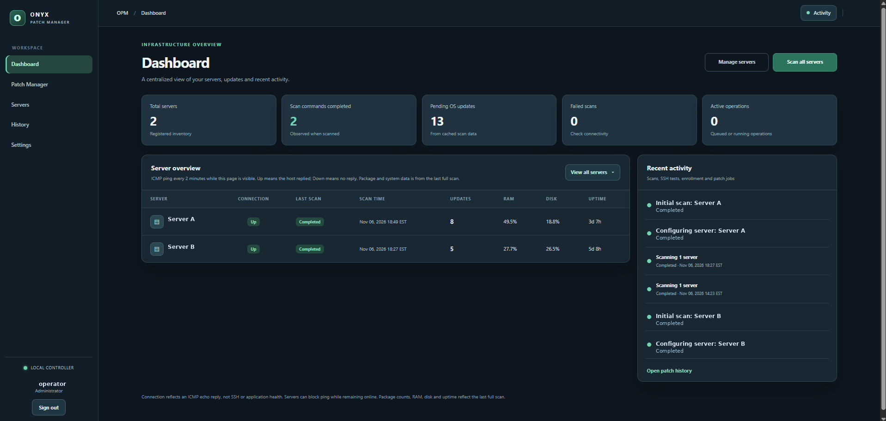
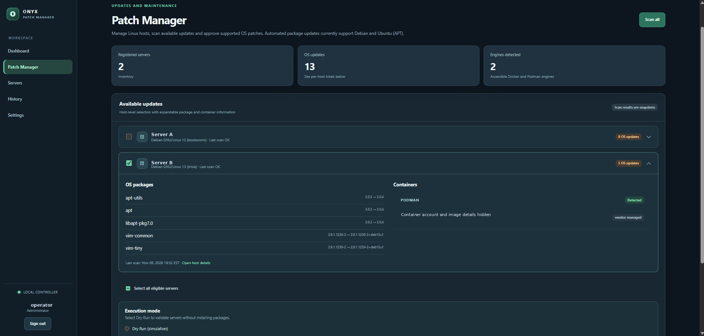
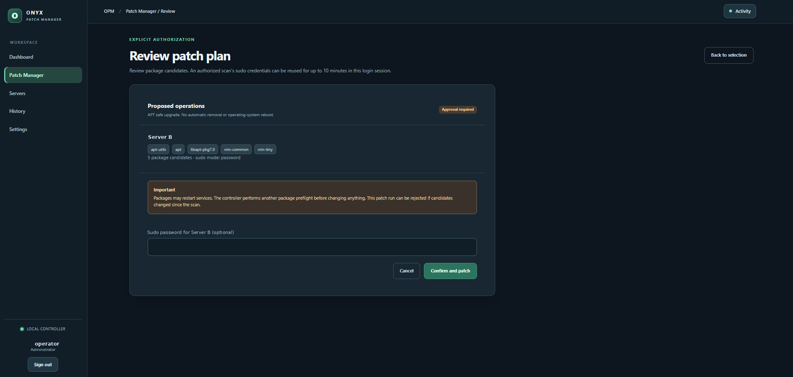
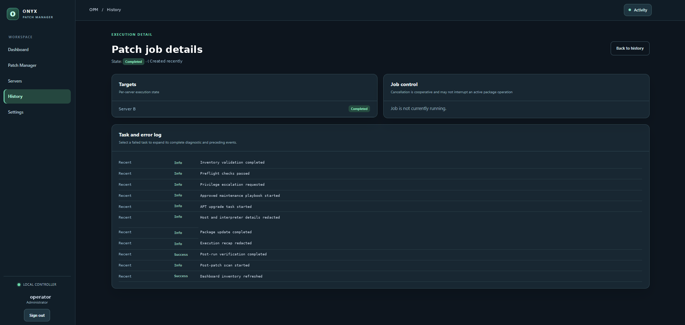
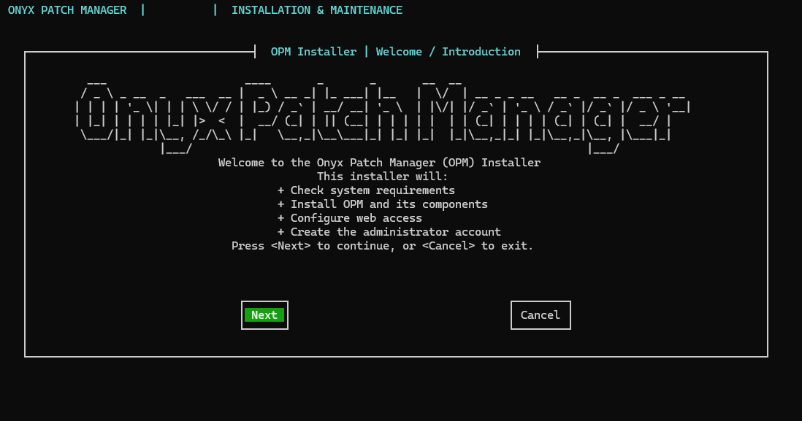

# Onyx Patch Manager

Onyx Patch Manager (OPM) is a self-hosted tool for reviewing and managing Linux server maintenance from one web interface. It connects to managed servers over SSH and uses Ansible for supported patch operations.

## What it does

- Keeps an inventory of enrolled servers and their scan status.
- Finds available APT updates on Debian and Ubuntu servers.
- Lets an operator review a patch plan, run a dry run, or explicitly approve applying updates.
- Tracks background jobs and their results in activity and history views.
- Displays Docker and Podman inventory for visibility; container image and Compose updates are not applied.
- Supports Administrator, Operator, and Viewer roles.

OPM does not schedule unattended operating-system patching or automatically reboot managed servers.

## Getting started

1. Prepare a dedicated Debian 13 VM or LXC for the OPM controller.
2. Download and extract a source archive from [GitHub Releases](https://github.com/dnurse/onyx-patch-manager/releases).
3. From the extracted project directory, launch the installer:

   ```bash
   sudo bash OPMInstall.sh
   ```

4. Follow the setup wizard to configure web access and create the initial administrator account.
5. Sign in, add a Debian or Ubuntu server, review its SSH host fingerprint, and enroll it. Scan servers before reviewing a patch plan.

For upgrades and maintenance, see [UPGRADE.md](UPGRADE.md). For deployment and access guidance, see [SECURITY.md](SECURITY.md).

## Network access

Keep OPM on a trusted LAN or VPN, or place it behind a restricted internal HTTPS reverse proxy. Direct LAN/VPN HTTP does not encrypt credentials in transit. Do not expose the OPM web port directly to the public internet.

## Supported patching

Automated operating-system update discovery and patch execution target APT-based Debian and Ubuntu systems. Docker and Podman discovery is informational only; OPM does not pull images or apply Docker/Podman Compose changes.

For release-specific changes, see [GitHub Releases](https://github.com/dnurse/onyx-patch-manager/releases) and `RELEASE_NOTES.md`.

## Screenshots

These representative interface screenshots have been anonymized: server names, account names, job identifiers, runtime container identity, exact timestamps, and the captured application-version badge have been removed.

| Dashboard | Patch Manager |
|---|---|
|  |  |

| Patch review | Job history |
|---|---|
|  |  |

### Installer welcome


